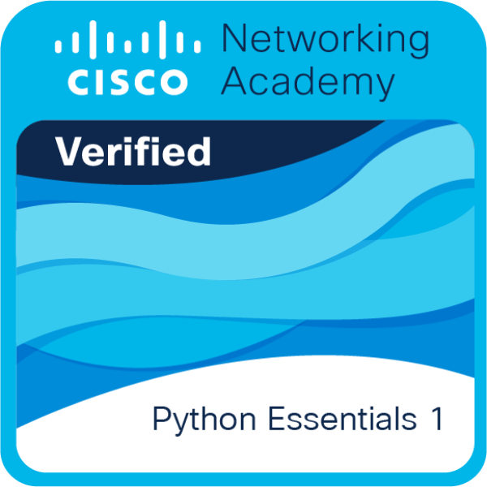

# ¡Hola! Soy Audel 

Desarrollador en formación apasionado por crear soluciones tecnológicas y aprender nuevas herramientas cada día. Actualmente enfocado en el desarrollo web y la lógica de programación.

- 🐍 Actualmente trabajando con **Python**.
- 🌐 Construyendo interfaces con **HTML & CSS**.
- 🐧 Usuario de **Linux** y de windows.
- 📚 Estudiante tecnico en programacion.

---
### Mis Tecnologías
 
 
 

CERTIFICACIONES
Cisco Networking Academy

